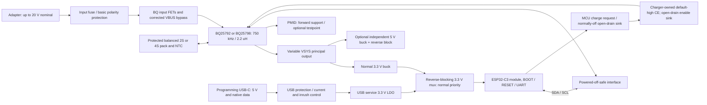

# V4 architecture — owner-approved simplified schematic direction

## Governing safety architecture — 2026-10-11

Owner decisions close the two architecture questions: **retain R12/C26 2 ohm + 2.2 uF**, with no added active OVP/eFuse; accept BQ25792 default-2 A charging with a qualified **2S1P/two-18650** pack. Four cells are **4S1P**, not 2S2P. Preserve nominal 0.5 A firmware charging and existing default-off CE. No external limiter, supervisor or watchdog solely for a 0.5 A hardware ceiling. Actual pack/current/temperature qualification and prototype transient/power-path validation remain OPEN. [Decision report](evidence/v4-safety-design-review-2026-10-11.md) supersedes historical architecture-open statements; no CAD, routing, fabrication or power-up is authorized by this documentation decision.

2026-10-10 · Requirements: [V4_REQUIREMENTS.md](V4_REQUIREMENTS.md) · Population: [V4_VARIANTS.md](V4_VARIANTS.md). Phase 0 is accepted for planning; owner decisions below supersede the original Phase 1 proposals. Phase 2 is authorized in small reviewable stages; initial operation and qualification are VSYS-only. Progress is recorded in [V4_PHASE2.md](V4_PHASE2.md).

## System architecture

Authority: the owner's 2026-10-10 simplification supersedes older Phase 3.2 circuitry and acceptance assumptions. USB is internal service access for initial programming/debug/recovery; OTA handles routine updates. Occasional MCU restarts on source transitions are acceptable; supported VSYS operation remains independent of MCU execution. No external timeout, charge latch, D flip-flop or fresh-edge authorization is required.

USB never feeds the charger input, optional5V or SYS. Ground is common. Programming D+/D− connect directly to the C3 USB interface with appropriate ESD/series provisions; they are not routed through the charger or a USB–UART bridge.

## A01 — Power path, outputs and load classes (R01/R05)

| Alternatives | Trade-offs | Recommendation | Unresolved verification |
| --- | --- | --- | --- |
| VSYS primary; PMID primary with firmware rearming; fixed12V integrated | VSYS follows pack and needs load voltage tolerance or an external converter. PMID backup adds transition/recovery dependencies and adapter pass-through voltage. Fixed12V adds size/loss for one installation. | **VSYS exclusively for this phase**, for BQ25792 and BQ25798; optional PMID testpoints/DNP provisions only. 2S targets 5V/2A. 4S targets higher-power external converters, including a 36W installation. No integrated12V or PD circuitry. | Each load's voltage/startup/UVLO limits; simultaneous outputs, cable drops, pack sag and thermal envelope. PMID load operation is deferred; retained test access may carry up to21V. |

For 4S / external12V3A, plan 20V3A adapter operation. A 12V3A adapter cannot sustain that load through both the charger stage and external regulator under the stated loss assumptions. At insufficient adapter power, battery supplementation is expected and must be reported. Optional5V and charging consume the same budget; neither is “free” when another output is at its maximum. See the source/load arithmetic in R05; no 2S12V3A rating is required.

## A02 — Adapter protection and ratings (R03)

| Alternatives | Trade-offs | Recommendation | Unresolved verification |
| --- | --- | --- | --- |
| Basic fuse/polarity protection; active OVP/eFuse | Reliable supported-adapter operation needs correct ratings, fuse coordination and hot-plug control; excluded 25/30V misuse does not justify another active stage. | **Basic input protection**, regulated adapters up to20V nominal/21V including tolerance; ≥35V input/PMID capacitors. No active OVP/eFuse requirement. | Check supported-source ringing, VDS/VGS/SOA, fuse/wire/connector ratings and 5V headroom. Add damping/clamp only if evidence requires. |

VAC1 architecture is closed by owner retention of R12/C26; physical hot-plug qualification remains OPEN. See the [current safety report](evidence/v4-safety-design-review-2026-10-11.md) for layout/parasitic sensitivity, fixture tests and fabrication/controlled-power-up gates. Keep BQ-controlled input FETs, VAC1 sensing of the actual adapter node and verified single-input VAC2 behavior. AON7528 remains subject to waveform/SOA/gate-drive qualification. D1 is a gate clamp, not an adapter TVS. F01 is mandatory. The prior 22V trip/23V ceiling/30V survival specification remains withdrawn.

## A03 — Charger/cells/frequency (R04)

| Alternatives | Trade-offs | Recommendation | Unresolved verification |
| --- | --- | --- | --- |
| BQ25792 common SYS profiles; BQ25798 common SYS plus backup; 1.5MHz/1µH versus 750kHz/2.2µH | BQ792 can suit cost/availability but needs pack-removal/default-current care. BQ798 provides backup capability and has different defaults/register use. Smaller inductor at1.5MHz is not a drop-in cost/layout change. | **Support both MPNs on one verified RQM footprint**, use BOM-specific 8.2kΩ2S / 27kΩ4S (1%) and 750kHz/2.2µH. Qualify both ICs in VSYS mode; preserve the recorded Eaton L1 provisionally. | Full BQ792 PDF/register/split-land comparison, actual installed inductor, core loss, capacitor curves, assembly-ID mapping and pack protection. No pin-compatible substitution without these checks. |

The audit's BQ25792 2S2A default is an explicit design input. The older board's CE-to-ground default shall not be copied. Firmware may lower input/charge limits after identity/readback; it must not rely on a register write to protect the first milliseconds of startup. No charging before a valid pack/NTC is established. BQ792 pack removal or BMS opening can cause SYS disturbances when charging is enabled; absence detection, immediate CE release where feasible and measured recovery are required before that variant is qualified. [TI pack-absence discussion](https://e2e.ti.com/support/power-management-group/power-management/f/power-management-forum/1332579/bq25792-high-temperature-charging-issue).

## A04 — Default-off CE and simple host control

Use a charger-domain pull-up and a normally-off open-drain MCU-controlled sink, with hardware pull-down bias and safe domain isolation. CE HIGH disables charge; CE is not RESET. Firmware enables charging explicitly after successful charger/profile validation. No external 250 ms authorization timeout, latch, D flip-flop, live-arm or fresh-edge mechanism is required. Additional safety circuitry needs a concrete justification and owner review. [V4_CE_REVIEW.md](V4_CE_REVIEW.md) records bias/startup verification and the residual default-current risk.

Boot with the sink off; identify IC/cells/profile and pack/NTC; configure EN_CHG off, source/current/voltage limits and readback; enable EN_CHG and sink CE last. Release the sink before software register reset/CELL changes and on detected communications/profile/pack faults. Verify MCU reset, brownout and ROM states release the sink independently of application startup. A stalled host may hold CE low until MCU watchdog recovery: there is no independent 250ms cutoff.

BQ25792 2S1P can restore2A after charger-only reset while the host sink remains on. Detection latency is **not bounded by external hardware**. The owner accepts this behavior through qualification of both individual cells, pack, BMS and wiring for sustained default charging including tolerance and temperature. Normal nominal0.5A firmware control and default-off CE remain; no independent limiter is selected. Actual pack approval and prototype validation are OPEN. Four cells are4S1P, never an assumed2S2P workaround.

## A05 — Normal buck and service-USB LDO (R06/R07)

Latest owner decision: **U3 TPS62933 buck for normal VSYS → MAIN_3V3, U4 simple 3.3 V LDO for USB-only service, U5 TPS2116 normal-priority mux.** The prior USB-buck recommendation and optional-only LDO status are superseded. One physical PCB/population design remains; this is not another regulator variant.

Select Diodes **AP7361C-33E-13**, fixed 3.3 V, SOT-223 (E, not ER), as the provisional U4 LDO. It has 1 A IC capability; actual service load is lower and thermal/source limited. Retain input/output ceramic bypass to meet manufacturer effective-capacitance requirements; remove the USB buck inductor, bootstrap, feedback, soft-start and EN-divider parts. No hold-up/load-switch/reset-supervisor stage is added. [Manufacturer datasheet DS37274 Rev. 5-2](https://www.diodes.com/datasheet/download/AP7361C.pdf), pin table/application/thermal sections; [bounded selection and calculations](evidence/phase3-4-usb-ldo-selection.md).

The LDO operates only for initial programming, debug and recovery with Wi-Fi disabled. Native ROM flashing works without battery/adapter or functioning application firmware. USB-C may stay inside the enclosure; BOOT/RESET remain service-accessible, with routine updates via OTA.

Select power after conversion at 3.3 V. Keep TPS2116 reverse blocking on both inputs and all signal-domain isolation: an LDO alone is not reverse protection. Source-transition MCU resets are acceptable; the supported main VSYS path remains independent of MCU execution. Respect actual USB current allowance, including pre-configuration behavior. Record ROM peak/average current, inrush, cable drop and LDO temperature later; no measurement is inferred from its 1 A rating.

## A06 — Mux, reverse blocking and domain boundaries

| Alternatives | Trade-offs | Recommendation | Unresolved verification |
| --- | --- | --- | --- |
| TPS2116-class mux; ideal-diode controllers with external back-to-back FETs; passive diode OR | Mux integrates priority/slew/reverse functions; controller solution can tighten isolation but adds parts; passive OR loses voltage. Reverse-blocking transition thresholds are not zero. | **TPS2116DRLR candidate at3V3**, normal input priority; output→MCU only. Review maximum leakage/dynamic behavior against R07; add blocking only for a demonstrated unsafe path. | Maximum leakage at all temperatures, output-source reverse threshold/time, source-collapse rate, priority hysteresis, control-pin partial power and startup and recovery. |

TPS2116 supports1.6–5.5V and reverse blocking, but has a finite comparator threshold/response. Do not characterize it as an ideal zero-leakage diode. Source selection shall be hardware-driven; an MCU that has not yet booted is not required to select its own power. [TI SLVSFG1A §6–8](https://www.ti.com/lit/gpn/tps2116).

Use the built-in priority comparator with a MAIN-referenced divider instead of an external MAIN supervisor where datasheet limits permit. Check threshold tolerance and normal-only startup; do not derive the threshold from the mux output in a way that prevents startup. Direct mux-to-MCU power and ordinary local bypass replace the TPS22975 slew stage and 470 uF hold-up candidate. Restart tolerance removes their continuity rationale; USB inrush and valid operating limits still require verification.

| Path / direction | Required treatment; alternatives and pending checks |
| --- | --- |
| MCU3V3→normal buck output→SYS; normal power→USB converter→VBUS | Reverse-blocking mux on both inputs. Verify disabled/unpowered source and transition behavior; add separate source blockers if needed. Normal buck output capacitors remain before the mux. |
| MCU SDA/SCL↔BQ | Powered-off-safe bus isolation. Original non-A TCA9517DGKR: A-side supply/pull-ups MAIN_3V3, B-side supply/pull-ups MCU3V3; isolated EN with safe power-off state. Preserve Q8/Q9 isolation of the internal EN pull-up. Check buffered VOL against BQ VIL and rise times. |
| MCU charge request→CE sink | Ioff-safe buffer/switch, or insulated-gate MOSFET translation with main-owned drain pull-up. Gate defaults low/off during MCU reset/unpowered/ROM states. Verify no backfeed and valid main power before enabling. |
| Main CE→MCU | CE driven only by charger-owned pull-up and open-drain sink. **No direct MCU pin.** Omit CE readback or use a separate Ioff-safe sensing path; resistive division alone is insufficient. |
| BQ INT→MCU | Prefer small discrete MOSFET level translation: INT pull-up normal3V3 drives gate, source common ground, drain pulled to MCU3V3. Inverts polarity, which future firmware must handle. Verify input/output polarity, minimum VGS, gate resistances, leakage and power-up ambiguity. Ioff buffer is an alternative. |
| BQ STAT→MCU | Retain charger-domain LED if useful; omit MCU connection by default (status via I²C). Any optional telemetry connection needs the same powered-off-safe treatment as INT. |
| ADC voltage sense: BAT/SYS/PMID/VIN→MCU | Use charger ADC/I²C by default. No direct main-rail divider into a USB-powered or unpowered MCU. If later required, use a qualified disconnected sensing path with safe off-state leakage and fault voltage. |
| REGN/TS/PROG/BATP/SDRV/ACDRV | Charger-only domain; no USB/MCU supply pull-ups or control wires. Preserve analog/temperature and gate-drive requirements. |
| Mux ST/MODE/priority, regulator EN/PG, USB-present detection | Pull-ups/dividers stay within their own powered domain; expose to MCU only with guaranteed partial-power behavior. Prefer autonomous hardware selection, omit unnecessary status crossings. |
| Optional5V output→its buck→SYS | Output reverse blocker after the buck if backdrive is supported or foreseeable; no connection to USB5V. Select current/voltage/thermal ratings and check DNP state. |
| USB D+/D−, CC, ESD and VBUS sense | C3-only data path. ESD clamps shall not inject into an unpowered shared/main rail; verify any VBUS-present sense. CC1/CC2 separate Rd to ground. Protect VBUS and meet current/inrush limits. |
| Optional emergency UART / separate measurement access | Native USB Serial/JTAG is primary. UART row has only ESP_TX(GPIO21),ESP_RX(GPIO20),GND; no3V3 contact. Enforce a powered-target3.3V-logic interface, external outputs highZ while off and adapterVCC disconnected. MCU3V3/MAIN_3V3 measurement pads are separate elsewhere. Existing BOOT/RESET buttons remain; no extra EN/BOOT/I2C pogo pads. CE_N passive probe stays separate in charger domain. No bypass of domain isolation or undocumented supply input. |

A shared-ground discrete MOSFET signal translator has no intended DC gate-to-drain power path, but leakage and capacitive coupling still need maximum-spec/bench assessment. TCA9517 powered-off behavior does not automatically qualify its enable source or whole bus. The 10 µA aggregate value is a measurement target under R07; unsafe back-power and component-limit violations remain prohibited. [TI SCPS242D §5–8](https://www.ti.com/lit/gpn/tca9517). Every added GPIO needs a crossing review.

### Power-state acceptance table

| State | MCU source / charge state | Must demonstrate |
| --- | --- | --- |
| USB only; BQ missing/stuck bus | USB3V3 / permission off | Native ROM flash, bounded local diagnostics; main rails not unsafely energized; measure R07 leakage target |
| Battery only | Normal3V3 / no adapter charge; CE remains fail-safe | USB connector not energized; load supplied until qualified low-pack limit |
| Adapter only, battery absent | Normal3V3 / CE high | SYS boot without charge pulses/BATOVP-induced resets; monitor detects absent pack |
| Adapter+pack | Normal3V3 / arm only after validated profile | Correct charge/load sharing, NTC control and readback; detected fault releases CE |
| USB+any main source | Normal-priority mux / normal charge rules | No unsafe back-power; occasional MCU restart is acceptable; supported VSYS output remains operational |
| MCU reset/ROM/missing | Any surviving source / CE high through released sink | Fail-safe sink release; no Wi-Fi/OTA dependence |
| BQ-only reset while charging | Normal source may survive / revoke and revalidate | Default-current risk and host response measured against actual cell limits |
| BMS opens or pack hot-unplugs, NTC remains | Main source if present / revoke | BQ792 SYS stability, absence detection and recovery measured |
| External5V applied; buck fitted or DNP | No inferred MCU source / CE remains fail-safe | No backfeed to SYS; no route around optional output blocker |

## A07 — ESP32-C3 recovery and GPIO allocation

| Alternatives | Trade-offs | Recommendation | Unresolved verification |
| --- | --- | --- | --- |
| Official C3 module/native USB; development board; discrete C3 RF design; USB–UART bridge | Module keeps RF/crystal/flash proven and removes dev-board bulk. Bare RF adds substantial qualification. Bridge adds components and is unnecessary for native recovery. | **Official C3-MINI-1**, candidate N4X; native USB plus BOOT/RESET and UART pads. Keep programming power independent of BQ. | Suffix/availability/land pattern, ROM/eFuse behavior, source current, straps/reset timing, antenna/enclosure clearance and future PlatformIO target. |

Saved allocation: USB GPIO18/19; UART20/21; BOOT9; GPIO2/8 straps; SDA4/SCL5; LED3; INT6; charge request GPIO0 (module pad 12); GPIO7 reserved. Verify charge GPIO reset/ROM state and pull-down. No heartbeat/lease GPIO is needed. This is a schematic allocation, not a firmware implementation. Use manufacturer-recommended EN pull-up/RC, RESET and BOOT buttons, internal brownout recovery, local bypass and antenna keepout. No external reset supervisor is required solely for source-transition continuity. Native ROM recovery must work with blank/broken application, absent charger and USB alone. Service USB may be inside the enclosure; routine updates use OTA. [Module v2.2](https://documentation.espressif.com/esp32-c3-mini-1_datasheet_en.html), [Espressif reset/USB/strap guidance](https://docs.espressif.com/projects/esp-hardware-design-guidelines/en/latest/esp32c3/schematic-checklist.html).

## A08 — Normal3V3 and optional5V

| Alternatives | Trade-offs | Recommendation | Unresolved verification |
| --- | --- | --- | --- |
| Wide-input buck(s); LDO from VSYS; cascaded5V→3V3; external modules | VSYS LDO wastes watts on4S; cascaded rail couples critical MCU power to optional5V population/faults; modules retain size/specification uncertainty. | **Independent normal3V3 and optional5V bucks from VSYS.** TPS62933DRLR candidate for both, separate passives. Normal3V3≥1A capability; optional5V2A target, not3A promise. | Efficiency at6/8/13/18V, low-end5V dropout, peak/short current, core/thermal/EMI/layout, output blocker drop and component life. |

A30V buck input rating provides margin; it does not raise BQ SYS limits or authorize a raw20V connection to a3V3 mux. Optional5V backfeed protection is its own DNP group. Source-presence/enable circuits must not create a leak around either regulator. Future firmware should report low battery and shed optional loads before pack cutoff when appropriate; electrical undervoltage safety cannot depend entirely on MQTT/Wi-Fi.

## A09 — Forward-mode capacitance and deferred backup

Retain mandatory VBUS/PMID/SYS/BAT/REGN/bootstrap/BATP/SDRV support. Optional C20/C22 and C24/C25 bulk can be DNP only after forward-mode Ceff, hot-plug and SYS load-step review; exclude legacy20V bulk from any20V nominal assembly. Exact≥35V input/PMID replacement MPNs and package fit remain open.

PMID backup operation, hold-up sizing, VOTG and recovery tuning/qualification are deferred. Optional testpoints and DNP backup footprints do not authorize a backup assembly. The original PMID concept assumed approximately equal adapter and backup output voltages; the previous proposed15/20V adapter to12V backup qualification is withdrawn.

## A10 — Mechanical/stackup and BOM workflow

| Alternatives | Trade-offs | Recommendation | Unresolved verification |
| --- | --- | --- | --- |
| Separate PCBs; one board plus uncontrolled jumpers; one board with named population groups | Separate layouts violate scope. Jumpers permit hazardous mismatches. Explicit groups make procurement and assembly reviewable. | One four-layer starting design, encoded cell/IC/profile identity, fixed RPROG per BOM, common protected input, optional5V and backup groups. Use assembly-specific BOM fields/CSV as documented equivalent to KiCad variants. | Final fab stackup/copper/plating, package escapes/current paths, enclosure/USB/M3/RF geometry, connector ratings, exact encoding and generation checks. |

TME preference is a sourcing rule, not a reason to choose an inadequately specified regulator. Preserve verified Source/Bought/Parameters/LCSC fields and add normalized MPN/variant data. No stock/price assertion is made. Do not let Konnect's current default two-layer/LCSC settings override these requirements.

## A11 — CAD preflight and authorized stages

The [Phase1 probe](evidence/phase1-konnect-availability.json) is historical: its missing bindings/IPC are not current facts. Phase2 now has callable Konnect tools and a responsive KiCad10.0.7 IPC ping. PCB document enumeration returned AS_UNHANDLED; no exact V4 live board has been confirmed. See [Phase2 progress/evidence](V4_PHASE2.md).

All V4 CAD mutations target hardware/v4/ups_v4/ exclusively. V2/V3 remain read-only references. File-based schematic changes may proceed through Konnect. **Before each live PCB change**, confirm the exact full V4 PCB path through Konnect IPC; a responsive ping or a different open board does not satisfy this gate.

Start with a copied charger/power-stage schematic and F01; review saved connectivity/ERC/diff/render evidence before subsequent electrical blocks. Next stages implement CE/bias, forward-mode rated passives/input/fusing and shared BQ792/798 pin-map verification, then USB/MCU/regulators, then PCB integration. Each coherent change requires relevant checks; unfinished legacy circuitry must be clearly identified. Both ERC and DRC/parity plus hardware qualification remain release gates.

## Owner decisions and remaining gates

Approved direction: one PCB, VSYS-only initial operation, regulated ≤20 V nominal adapters, basic input protection, simple default-high CE/open-drain firmware enable without timeout/latch/fresh-edge authorization, service USB supply plus reverse-blocking 3V3 mux and safe signal-domain isolation. Routine updates use OTA and MCU source-transition restarts are acceptable. Keep the load/source budgets and optional independent5V block.

Open engineering checks: CE bias startup/reset for both ICs; actual2S1P pack/cell/BMS/wiring default-current qualification; shared split-land/pin mapping; exact fuse/capacitor/transient/inductor qualification; MCU/mux/interface MPNs and powered-off leakage; hardware thermals and load/recovery tests. R12/C26 retention and pack-based acceptance of2A are closed architecture decisions. These open checks justify specific validation, not automatic protection additions. Present small stages for review; no design release or general routing authorization follows.
