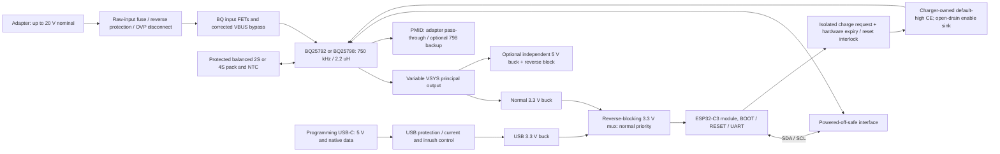

# V4 architecture — Phase 1 recommendations for review

2026-10-10 · Requirements: [V4_REQUIREMENTS.md](V4_REQUIREMENTS.md) · Population: [V4_VARIANTS.md](V4_VARIANTS.md). Phase 0 is accepted for planning; these decisions are proposed for review, not electrical implementation approval. No schematic, PCB, project/library or firmware file changed.

## System architecture

USB never feeds the charger input, optional5V or SYS. Ground is common. Programming D+/D− connect directly to the C3 USB interface with appropriate ESD/series provisions; they are not routed through the charger or a USB–UART bridge.

## A01 — Power path, outputs and load classes (R01/R05)

| Alternatives | Trade-offs | Recommendation | Unresolved verification |
| --- | --- | --- | --- |
| VSYS primary; PMID primary with firmware rearming; fixed12V integrated | VSYS follows pack and needs load voltage tolerance or an external converter. PMID backup adds transition/recovery dependencies and adapter pass-through voltage. Fixed12V adds size/loss for one installation. | **VSYS primary**; accessible optional PMID, qualified backup only with BQ25798. 2S targets 5V/2A. 4S targets higher-power external converters, including a 36W installation. No integrated12V or PD circuitry. | Each load's voltage/startup/UVLO limits; simultaneous outputs, cable drops, pack sag and thermal envelope. PMID loads must tolerate up to 21V normal adapter pass-through or use an external converter. |

For 4S / external12V3A, plan 20V3A adapter operation. A 12V3A adapter cannot sustain that load through both the charger stage and external regulator under the stated loss assumptions. At insufficient adapter power, battery supplementation is expected and must be reported. Optional5V and charging consume the same budget; neither is “free” when another output is at its maximum. See the source/load arithmetic in R05; no 2S12V3A rating is required.

## A02 — Adapter protection and ratings (R03)

| Alternatives | Trade-offs | Recommendation | Unresolved verification |
| --- | --- | --- | --- |
| Keep 20/25V caps and rely on charger OVP; TVS-only input; active raw-input OVP disconnect plus local damping | Existing caps lack the selected margin. TVS standoff/breakdown/clamp tolerances leave a difficult 21V continuous / 23V peak window and may require substantial surge dissipation. Active protection costs parts and conduction loss, but can disconnect a sustained overvoltage. | **Active ≥40V, preferably 60V-class protection** upstream of all BQ adapter sensing/FET circuitry; target trip22V, protected peak≤23V. ≥35V protected-input/PMID caps, exact DC-bias qualification. | Select controller/eFuse and FETs with reverse blocking, 3A continuous capability, OVP accuracy, response, SOA and inrush behavior. Verify the 30V/100ms bounded test and actual source faults. No protection MPN is frozen. |

Keep the BQ-controlled back-to-back input switch function for the backup option unless complete reference analysis shows the upstream circuit can replace it. Account for two blocking stages' losses and headroom at 5V. Never bypass OVP by connecting VAC1 to unprotected VIN_RAW. AON7528 may remain only downstream of the protected envelope and after SOA/gate-drive review. Gate zener D1 remains a gate clamp, not an adapter TVS. F01 is an obligatory correction, not a cost option.

## A03 — Charger/cells/frequency (R04)

| Alternatives | Trade-offs | Recommendation | Unresolved verification |
| --- | --- | --- | --- |
| BQ25792 common SYS profiles; BQ25798 common SYS plus backup; 1.5MHz/1µH versus 750kHz/2.2µH | BQ792 can suit cost/availability but needs pack-removal/default-current care. BQ798 provides backup capability and has different defaults/register use. Smaller inductor at1.5MHz is not a drop-in cost/layout change. | **Support both MPNs on one verified RQM footprint**, use BOM-specific 8.2kΩ2S / 27kΩ4S (1%) and 750kHz/2.2µH. Prefer BQ798 for backup; preserve the recorded Eaton L1 provisionally. | Full BQ792 PDF/register/split-land comparison, actual installed inductor, core loss, capacitor curves, assembly-ID mapping and pack protection. No pin-compatible substitution without these checks. |

The audit's BQ25792 2S2A default is an explicit design input. The older board's CE-to-ground default shall not be copied. Firmware may lower input/charge limits after identity/readback; it must not rely on a register write to protect the first milliseconds of startup. No charging before a valid pack/NTC is established. BQ792 pack removal or BMS opening can cause SYS disturbances when charging is enabled; absence detection, immediate CE release where feasible and measured recovery are required before that variant is qualified. [TI pack-absence discussion](https://e2e.ti.com/support/power-management-group/power-management/f/power-management-forum/1332579/bq25792-high-temperature-charging-issue).

## A04 — Default-off CE and charge-permission sequence

| Alternatives | Trade-offs | Recommendation | Unresolved verification |
| --- | --- | --- | --- |
| CE permanently low, program limits later; autonomous2A charging with compatible pack; default-high CE with fresh host permission; independent hardware charge-current limit | First option exposes POR current. Autonomous mode is simpler but restricts cells and needs pack/NTC-safe defaults. Host gating prevents startup charge but cannot alone cap current after an unobserved charger-only reset. Independent current limiting adds loss, cost and another fault path. | **Default-high CE and expiring host permission**, common across all profiles. Initial host charge≤0.5A, subject to cells/source. Require qualified bounded POR-current tolerance or independent limiter for BQ7922S; autonomous2A startup is not selected. | Charger-owned pull-up bias/ramp sequencing, exact reset/watchdog behavior, external lease circuit/timing, pack2A interval tolerance and charge-current tolerances. Treat these as schematic gates, not proven safety. |

Proposed circuit functions, without assigning new CAD references:

1. Bias CE high through a resistor from a **charger-owned CE_BIAS**. Candidate bias is a diode OR of REGN and normal3V3, so REGN can assert disable before the normal buck starts, and battery-only operation can hold it high even when REGN sleeps. Both sources are main-domain supplies; neither is MCU/USB3V3. Verify diode leakage, CE voltage limits and REGN startup. If it cannot guarantee disable before charging is possible, use a separate always-available main-domain bias arrangement. Do not power unrelated loads from REGN.
2. Pull CE low only through normally-off, adequately rated open-drain devices. Two series sink conditions implement `HOST_ARM AND HW_PERMIT`; gate pull-downs enforce off with missing MCU, reset or lost normal power. No direct 5V CE-to-C3 connection. Include test access without a fitted force-charge jumper.
3. Main-domain reset/timeout logic revokes HW_PERMIT on MCU reset/brownout, invalid main supply, initial startup and expiry. A fresh validation-derived heartbeat renews a nominal lease whose **worst-case expiry≤250ms**. Keep the sink off while the watchdog starts. Interface ARM/heartbeat/reset using powered-off-safe logic or discrete MOSFET translation, not an ordinary input clamp into an unpowered rail.
4. Boot with ARM low; identify IC and assembly/cells, verify NTC and pack presence, disable EN_CHG while configuring, write source/voltage/current/temperature settings, verify readback, then enable EN_CHG and arm the CE sink last. CE must already be high before any software register reset or CELL change.
5. On I²C failure, profile mismatch, absent pack or watchdog/reset indication, release ARM first and reacquire a safe profile. Wi-Fi must not delay this path. No permission is stored across reset or restored simply because an adapter reappears.

CE high is intended to stop charge while leaving SYS power-path operation available; verify no battery → adapter → SYS → normal3V3 → MCU bootstrap deadlock. Battery pack presence cannot be inferred from an NTC alone if the BMS opens while the NTC stays connected. Use a qualified detection procedure/interlock and verify pack-removal cases. A charger-only reset while the sink is on can restore2A during the detection/lease interval. The expiry circuit bounds an interval, **not its current**; actual pack qualification or independent limiting remains mandatory. This is the main unresolved charge-safety decision presented for review.

## A05 — USB conversion versus LDO (R06/R07)

Both architectures keep a VSYS→normal3V3 buck and select power **after conversion, at3V3**. Both need the same signal isolation and reverse-blocking mux. A regulator alone, a diode across an LDO, or a disabled regulator is not a proof of reverse isolation.

| Architecture | Relative cost/area | Loss at5V→3.3V | Startup / reverse-current issues | Recommendation and checks |
| --- | --- | --- | --- | --- |
| USB→3V3 synchronous buck +3V3 mux | Higher part count: IC, inductor, feedback and switching-loop layout; possible BOM reuse with other bucks | At assumed90%: 0.037W at0.1A, 0.183W at0.5A, 0.367W at1A. Light-load efficiency must be measured. | Soft-start/UVLO, switching noise, mux source slew and reverse pulses; no inherently safe regulator output assumed | **Baseline recommendation:** thermal/current margin without assuming low average programming current. Select a part valid at minimum USB voltage after input protection. |
| USB→3V3 LDO +3V3 mux | Fewer passives and no inductor; lower cost expected, **not quoted**; adequate thermal copper/package can offset area savings | `(VUSB−3.3)×I`:0.17W at0.1A,0.85W at0.5A,1.70W at1A (5.0V; worse at high USB voltage) | Usually simple start and low noise; reverse output conduction/discharge still isolated by mux. Small-package thermal rating may defeat headline current. | Credible cost alternative **only after** ROM/flash/diagnostic average and peak current, thermal copper, dropout and source budget pass. Program-only/no-Wi-Fi lowers average load but is not yet measured. |
| RawVSYS/USB mux before one regulator | Saves duplicate3V3 stage but requires high-voltage reverse-blocking mux across unequal sources | Depends on converter | More difficult source selection, reverse paths and USB5V dropout; TPS2116 cannot accept rawVSYS | Not selected; reconsider only with a fully specified high-voltage solution. |
| Schottky OR of two3V3 sources | Low cost/simple | Forward drop reduces MCU voltage/headroom | Leakage/hot behavior and regulator mismatch; cannot assume≤10µA or3.0V minimum | Not selected for reliability baseline. |

Candidate USB/normal buck: TPS62933DRLR (3.8–30V,3A class), with actual normal MCU target1A and USB target≥0.5A capability; this is an IC candidate, not a claim of3A USB availability. Check5V−cable−protection headroom against its minimum input. Candidate LDO for comparison: AP2112K-3.3TRG (600mA, SOT25); it is not a1A replacement and needs explicit thermal qualification at0.5A. If a higher-power LDO is selected, its larger thermal footprint must be costed. [TI buck SLUSEA4D](https://www.ti.com/lit/gpn/tps62933), [Diodes AP2112 datasheet](https://www.diodes.com/datasheet/download/AP2112.pdf).

No PCB footprints for every alternative are required. Select one USB conversion implementation at architecture approval; support the specified battery/charger/output BOM variants on the resulting one PCB. USB-only programming shall work on the supported data port's actual current allowance; high peak capability is a supply-design requirement, not permission to draw500mA before enumeration. Qualify ROM current and inrush under a100mA-limited legacy USB2 source; after enumeration allow only the advertised/configured current. Wi-Fi remains off in USB-only mode unless a sufficient source allowance is established. CC Rd alone grants no3A capability; no PD circuitry is added.

## A06 — Mux, reverse blocking and domain boundaries

| Alternatives | Trade-offs | Recommendation | Unresolved verification |
| --- | --- | --- | --- |
| TPS2116-class mux; ideal-diode controllers with external back-to-back FETs; passive diode OR | Mux integrates priority/slew/reverse functions; controller solution can tighten isolation but adds parts; passive OR loses voltage. Reverse-blocking transition thresholds are not zero. | **TPS2116DRLR candidate at3V3**, normal input priority; output→MCU only. Add dedicated blocking if its max leakage/dynamic behavior fails R07. | Maximum leakage at all temperatures, output-source reverse threshold/time, source-collapse rate, priority hysteresis, control-pin partial power and startup/hold-up. |

TPS2116 supports1.6–5.5V and reverse blocking, but has a finite comparator threshold/response. Do not characterize it as an ideal zero-leakage diode. Source selection shall be hardware-driven; an MCU that has not yet booted is not required to select its own power. [TI SLVSFG1A §6–8](https://www.ti.com/lit/gpn/tps2116).

| Path / direction | Required treatment; alternatives and pending checks |
| --- | --- |
| MCU3V3→normal buck output→SYS; normal power→USB converter→VBUS | Reverse-blocking mux on both inputs. Verify disabled/unpowered source and transition behavior; add separate source blockers if needed. Normal buck output capacitors remain before the mux. |
| MCU SDA/SCL↔BQ | Powered-off-safe bus isolation. TCA9517DGKR candidate: A-side supply/pull-ups MCU3V3, B-side supply/pull-ups normal3V3; main-domain-valid enable with safe power-off state. Alternative Ioff-rated analog bus switch has lower power but needs all port/EN partial-power conditions checked. Check buffered VOL against BQ VIL and rise times. |
| MCU ARM/heartbeat/reset→main permission logic | Ioff-safe buffer/switch, or insulated-gate MOSFET translation with main-owned drain pull-up. Default low/off, no static GPIO permission after boot. Review every gate/control bias and watchdog output. |
| Main CE→MCU | CE driven only by charger-owned pull-up and open-drain sink. **No direct MCU pin.** Omit CE readback or use a separate Ioff-safe sensing path; resistive division alone is insufficient. |
| BQ INT→MCU | Prefer small discrete MOSFET level translation: INT pull-up normal3V3 drives gate, source common ground, drain pulled to MCU3V3. Inverts polarity, which future firmware must handle. Verify input/output polarity, minimum VGS, gate resistances, leakage and power-up ambiguity. Ioff buffer is an alternative. |
| BQ STAT→MCU | Retain charger-domain LED if useful; omit MCU connection by default (status via I²C). Any optional telemetry connection needs the same powered-off-safe treatment as INT. |
| ADC voltage sense: BAT/SYS/PMID/VIN→MCU | Use charger ADC/I²C by default. No direct main-rail divider into a USB-powered or unpowered MCU. If later required, use a qualified disconnected sensing path with safe off-state leakage and fault voltage. |
| REGN/TS/PROG/BATP/SDRV/ACDRV | Charger-only domain; no USB/MCU supply pull-ups or control wires. Preserve analog/temperature and gate-drive requirements. |
| Mux ST/MODE/priority, regulator EN/PG, USB-present detection | Pull-ups/dividers stay within their own powered domain; expose to MCU only with guaranteed partial-power behavior. Prefer autonomous hardware selection, omit unnecessary status crossings. |
| Optional5V output→its buck→SYS | Output reverse blocker after the buck if backdrive is supported or foreseeable; no connection to USB5V. Select current/voltage/thermal ratings and check DNP state. |
| USB D+/D−, CC, ESD and VBUS sense | C3-only data path. ESD clamps shall not inject into an unpowered shared/main rail; verify any VBUS-present sense. CC1/CC2 separate Rd to ground. Protect VBUS and meet current/inrush limits. |
| UART / EN / BOOT / spare GPIO / test headers | MCU-domain3.3V logic only; UART pin is3V3 **sense**, not a power input. No externally driven header shall back-power the MCU/main rails when off; use isolation/series scheme with specified Ioff or explicitly enforce a powered-target interface. Exclude undocumented signal/power jumpers. |

A shared-ground discrete MOSFET signal translator has no intended DC gate-to-drain power path, but leakage and capacitive coupling still need maximum-spec/bench assessment. TCA9517 is powered-off-safe by specification; this does not automatically qualify its enable source, whole bus or the10µA aggregate requirement. [TI SCPS242D §5–8](https://www.ti.com/lit/gpn/tca9517). Every added GPIO is a new entry in this crossing table before approval.

### Power-state acceptance table

| State | MCU source / charge state | Must demonstrate |
| --- | --- | --- |
| USB only; BQ missing/stuck bus | USB3V3 / permission off | Native ROM flash, bounded local diagnostics; main rails unpowered within R07 leakage budget |
| Battery only | Normal3V3 / no adapter charge; CE remains fail-safe | USB connector not energized; load supplied until qualified low-pack limit |
| Adapter only, battery absent | Normal3V3 / CE high | SYS boot without charge pulses/BATOVP-induced resets; monitor detects absent pack |
| Adapter+pack | Normal3V3 / arm only after validated profile | Correct charge/load sharing, NTC control and readback; expiry releases CE |
| USB+any main source | Normal-priority mux / normal charge rules | No USB bypass into charger and no takeover glitch/reset when sources are removed |
| MCU reset/ROM/missing or stalled validation | Any surviving source / CE off after prescribed expiry | Fail-safe sink release; no Wi-Fi/OTA dependence |
| BQ-only reset while charging | Normal source may survive / revoke and revalidate | Default-current interval measured; pack tolerance or independent limiter proven |
| BMS opens or pack hot-unplugs, NTC remains | Main source if present / revoke | BQ792 SYS stability, absence detection and recovery measured |
| External5V applied; buck fitted or DNP | No inferred MCU source / CE remains fail-safe | No backfeed to SYS; no route around optional output blocker |

## A07 — ESP32-C3 recovery and GPIO allocation

| Alternatives | Trade-offs | Recommendation | Unresolved verification |
| --- | --- | --- | --- |
| Official C3 module/native USB; development board; discrete C3 RF design; USB–UART bridge | Module keeps RF/crystal/flash proven and removes dev-board bulk. Bare RF adds substantial qualification. Bridge adds components and is unnecessary for native recovery. | **Official C3-MINI-1**, candidate N4X; native USB plus BOOT/RESET and UART pads. Keep programming power independent of BQ. | Suffix/availability/land pattern, ROM/eFuse behavior, source current, straps/reset timing, antenna/enclosure clearance and future PlatformIO target. |

Provisional map: USB18/19; UART20/21; BOOT9; retain correct GPIO2/8 straps; SDA4/SCL5; LED3; INT6; charge ARM7. Heartbeat/reset-interlock signals need reserved unstrapped spare GPIO before schematic approval (e.g. GPIO10 subject to module pin/boot review). GPIO allocation is a proposal, not a firmware change. Do not silently reuse classic ESP32 GPIO22. Add proper reset RC/supervisor, local decoupling and antenna keepout. Module native ROM recovery must work with blank/broken application and absent charger. [Module v2.2](https://documentation.espressif.com/esp32-c3-mini-1_datasheet_en.html), [Espressif reset/USB/strap guidance](https://docs.espressif.com/projects/esp-hardware-design-guidelines/en/latest/esp32c3/schematic-checklist.html).

## A08 — Normal3V3 and optional5V

| Alternatives | Trade-offs | Recommendation | Unresolved verification |
| --- | --- | --- | --- |
| Wide-input buck(s); LDO from VSYS; cascaded5V→3V3; external modules | VSYS LDO wastes watts on4S; cascaded rail couples critical MCU power to optional5V population/faults; modules retain size/specification uncertainty. | **Independent normal3V3 and optional5V bucks from VSYS.** TPS62933DRLR candidate for both, separate passives. Normal3V3≥1A capability; optional5V2A target, not3A promise. | Efficiency at6/8/13/18V, low-end5V dropout, peak/short current, core/thermal/EMI/layout, output blocker drop and component life. |

A30V buck input rating provides margin; it does not raise BQ SYS limits or authorize a raw20V connection to a3V3 mux. Optional5V backfeed protection is its own DNP group. Source-presence/enable circuits must not create a leak around either regulator. Future firmware should report low battery and shed optional loads before pack cutoff when appropriate; electrical undervoltage safety cannot depend entirely on MQTT/Wi-Fi.

## A09 — Capacitance and backup population

| Alternatives | Trade-offs | Recommendation | Unresolved verification |
| --- | --- | --- | --- |
| Keep all historical bulk; omit only backup POSCAPs; omit all PMID bulk; smaller components | Excess bulk costs area/inrush; removing bulk without Ceff/load-step evidence risks instability or backup droop. | Keep mandatory ceramics; retain backup-capable bulk footprints on one board. SYS profiles omit dedicated backup bulk provisionally; BQ798 backup populates ≥70µF **effective PMID** minimum plus hold-up/ESR margin. Legacy20V bulk is excluded at20V nominal input. | Exact≥35V replacement MPNs, DC bias/temperature, transient hold-up time/ESR/ripple, SYS-mode adapter hot-plug with bulk DNP, lifetime and capacitance tolerance. |

C24/C25 are tuning/qualification footprints, not proven essential or proven removable. Their placement/population may be reduced only after measurement. First backup prototype retains suitable-rated supplemental bulk; SYS prototype compares DNP/populated configurations. All variants retain VBUS/SYS/BAT/REGN/bootstrap/SDRV/BATP support. Do not copy wrong dielectric/value/source labels from the audit BOM. [TI backup EVM §4.2/4.3](https://www.ti.com/lit/ug/sluucb5e/sluucb5e.pdf).

## A10 — Mechanical/stackup and BOM workflow

| Alternatives | Trade-offs | Recommendation | Unresolved verification |
| --- | --- | --- | --- |
| Separate PCBs; one board plus uncontrolled jumpers; one board with named population groups | Separate layouts violate scope. Jumpers permit hazardous mismatches. Explicit groups make procurement and assembly reviewable. | One four-layer starting design, encoded cell/IC/profile identity, fixed RPROG per BOM, common protected input, optional5V and backup groups. Use assembly-specific BOM fields/CSV as documented equivalent to KiCad variants. | Final fab stackup/copper/plating, package escapes/current paths, enclosure/USB/M3/RF geometry, connector ratings, exact encoding and generation checks. |

TME preference is a sourcing rule, not a reason to choose an inadequately specified regulator. Preserve verified Source/Bought/Parameters/LCSC fields and add normalized MPN/variant data. No stock/price assertion is made. Do not let Konnect's current default two-layer/LCSC settings override these requirements.

## A11 — Konnect availability and CAD preflight gate

Read-only probes on2026-10-10 are saved in [phase1-konnect-availability.json](evidence/phase1-konnect-availability.json):

- `list_toolboxes`: success,228 advertised tools; `load_toolset` for sch_analysis/verification/pcb_board: success,38 tools added, `errors=[]`; `get_active_toolsets`:52 active tools.
- `get_installation_info`: Konnect0.13.0, commit`6bbe3e4f890ba1d37c0e5d5f38ccd03d90958c9e`, KiCad CLI10.0.7, IPC not configured.
- Client check after loading: `check_kicad_ui`, `get_design_rules`, `get_net_connections`, `get_board_info` are **absent from callable client catalogue** and `typeof tools[...]` is `undefined`. No request to those functions was dispatched; this is a client binding/discovery limitation, not an observed CAD handler error.
- Read-only `open_project` status probe: `ipc_available=false`, `ipc_failure.kind=not_configured`, `kicad_ui_running=false`, no board open. Despite outer `isError=false`, this is **not** a successful live-board check. Its error advises enabling KiCad API, configuring IPC Socket and restarting the MCP client.
- `get_effective_config`: read succeeds, user file + project defaults. It reports JLCPCB/LCSC, two layers,0.15mm width/clearance. Those preferences conflict with user/project direction; **not applied**. No config was saved.

No CAD mutation, migration/save, new ERC/DRC run or firmware build was attempted in Phase1. Existing Phase0 counts remain historical baselines. Before Phase2: repair dynamic bindings or reconnect/restart the client, verify exact file/live target and readback capability, configure IPC if using live PCB editing, then prove available CAD tools on a disposable copy. If mutations remain unavailable, stop CAD work and report the exact limitation; do not hand-edit serialized files. Perform small coherent changes only after architecture review, with saved netlist/ERC/DRC/parity and diff evidence. Phase0 audit exports remain valid read-only planning evidence, not a substitute for this gate.

## Review decisions and remaining gates

Recommended for approval: single-board SYS architecture; 20V nominal with distinct protected transient target; F01 correction; default-off, expiring CE permission; USB buck plus3V3 reverse-blocking mux baseline; complete signal-domain isolation; independent optional5V; the load/source profiles and population groups.

Still unresolved before schematic approval: exact raw-input protection and transient waveform/source limits; CE bias/lease hardware and BQ7922S pack/default-current tolerance or independent limiter; complete charger register/package comparison; MCU suffix and spare GPIO; maximum-leakage-compliant interface/mux/blockers; TME-backed MPNs and capacitor curves. Before production rating: all prototype tests in R08. Architecture review does not waive any of these gates. **Stop at Phase1; no electrical design changes yet.**
