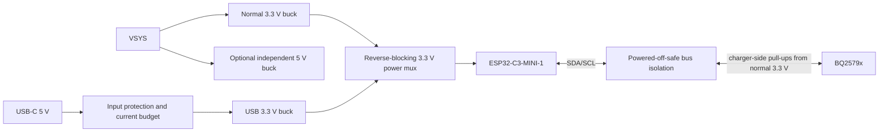

# UPS V4 — Phase 0 engineering audit

> Historical Phase 0 audit: recommendations and preliminary operating scenarios below are not current requirements. Later explicit owner decisions in V4_REQUIREMENTS.md and the current V4_HANDOVER.md supersede conflicting proposals. Genuine device limits and unresolved hazards remain subject to review.

Date: 2026-10-10. Baseline: `9065cace5a7a7f95a39692a55897cd89e01024ea`; development branch: `codex/v4-phase0-audit`.

**Disposition: proceed to architecture decisions after review; do not copy the existing power board unchanged into V4.** The clearest electrical defect is the isolated VBUS bypass network. The principal V4 changes are accessible VSYS power, a properly isolated USB-powered controller, explicit battery/charger variants, and enforceable fabrication and current-path constraints. The existing 2.2 µH inductor does not presently warrant replacement.

This document completes Phase 0 only. It contains proposals, not an approved schematic, rated product specification, fabrication release, or authorization to start Phase 1. No electrical design or firmware was changed.

## 1. Evidence, scope and confidence

Reviewed: saved main power, controller and historical breakout projects; exported BOM/netlists, board layers, placement/connectivity and ERC/DRC reports; `README.md`, switchover investigation notes, `software/ups` configuration and startup/control code. Existing on-device modifications and the exact installed parts cannot be established from repository files.

The [KiCad evidence summary](evidence/phase0-kicad-summary.md) links the machine-readable evidence. Main references are [component properties](evidence/phase0-main/main-components.csv), [nets](evidence/phase0-main/main-nets.csv), [IC1 pin map](evidence/phase0-main/IC1-pin-map.csv), [IPC-D-356 connectivity](evidence/phase0-main/main-ipc-d356.txt), [ERC](evidence/phase0-main/main.erc.json) and [DRC](evidence/phase0-main/main.drc.json). Calculations are reproducible with `python hardware/v4/evidence/operating-corners.py`; results are [CSV](evidence/operating-corners.csv).

Konnect 0.13.0 connected and advertised toolsets, but dynamically loaded review/analysis functions were not callable in this session. Fallback: KiCad CLI 10.0.7, saved-file exports and read-only project metadata. Live IPC inspection, Konnect aggregate review and controlled migration/save of a V4 design were not completed. Checks run on KiCad 8-era files establish that CLI 10 can read them, not that a subsequent GUI migration/save is verified. Disposable copies and downloaded manufacturer PDFs are locally ignored; no copies are V4 design files.

Confidence labels: **high** = direct source/export or manufacturer specification; **medium** = engineering inference from that evidence; **unverified** = needs physical inspection, missing data or measurement. Severity: **critical** = do not release an affected configuration; **high** = resolve before schematic/layout freeze; **medium** = resolve before prototype qualification; **low** = maintainability/cost improvement. Conditional findings are not assertions that an installed 12 V unit has failed.

## 2. Prioritized findings

| ID / severity | Component or net | Evidence and status | Recommended action | Confidence |
| --- | --- | --- | --- | --- |
| F01 — high | VBUS; C7/C13/C16; IC1.2/.3/.8; NT4 | **Confirmed:** exported `VBUS` contains only these three capacitors. Actual IC VBUS/VAC2 reaches NT4.1; Q2 drain reaches NT4.2. Thus the intended local VBUS capacitors are disconnected from their supply. DRC does not detect an electrically incomplete design when it matches the netlist. | Connect the VBUS bank to the correct input node in the future schematic, then inspect both netlist and copper. Check actual old boards/modifications before attributing measured behavior to this defect. | High |
| F02 — critical if input exceeds rating | C20/C22, PMID | **Confirmed conditional incompatibility:** recorded 20TQC47MYF is rated 20 V. PMID follows the adapter in normal operation; a 24 V input exceeds this rating, and 20 V leaves no transient margin. | Choose an explicit supported adapter range. For a 24 V variant replace the affected capacitors with suitably derated parts; do not advertise the IC's full input range as the assembly rating. | High |
| F03 — high | J2/J4 supply, TP4 | **Confirmed:** J2 output and controller supply are PMID; SYS reaches TP4 and its capacitors only. Labels say “12V” despite configurable/pass-through voltage. | Provide a real high-current VSYS connector, separate optional PMID access, rail voltage labels and keyed polarity. Preserve the old board's interpretation in documentation. | High |
| F04 — high | USB power and all MCU–charger signals | **Confirmed V4 requirement gap:** existing dev-module/external-converter architecture has no specified USB-only isolation network. A mux alone cannot stop GPIO/I²C back-power. | Adopt and verify the power/signal isolation proposal in §9; include USB-only, mixed-source and powered-off leakage acceptance tests. | High |
| F05 — high | Firmware initialization and C3 target | **Confirmed:** charger discovery/reset and invalid-cell paths contain unbounded waits; Wi-Fi setup precedes I²C; default GPIO22 is unavailable on C3. All current PlatformIO environments derive from classic `esp32dev`. | Add a C3 target/configuration and bounded charger-absent diagnostic state in a later firmware change. Keep ROM BOOT/RESET recovery independent of application/I²C/Wi-Fi. | High |
| F06 — high | 2S load and charging budgets | **Calculated:** 12 V × 3.32 A from a 6.4 V pack needs 6.92 A at assumed 90% efficiency, before auxiliary loads. This exceeds the 6 A continuous battery-path recommendation; OTG also has a 5 A switch-current recommendation. Input power must cover SYS plus charging. | Rate each source/pack/output combination, enforce limits and use a suitable external converter only within the battery-path budget. Do not transfer a 4S rating to 2S. | High for arithmetic; medium for achievable efficiency |
| F07 — high | IC1 variant and PROG/startup | **Confirmed:** 750 kHz uses 8.2 kΩ for 2S and 27 kΩ for 4S. BQ25792 2S POR charge current is 2 A; current BQ25798 documentation specifies 1 A. Backup functionality is not interchangeable. | Key assembly and firmware configuration to charger MPN/cell count; establish safe pre-firmware charging and verify complete package/pin/register compatibility before ordering. | High for documented settings; package sign-off open |
| F08 — high | Board rules / IC1 footprint | **Confirmed check limitation:** custom IC1 footprint library is unavailable; permissive historical constraints and broad POWER class cannot establish current capacity. Library mismatches are not automatically electrical errors. | Vendor/package land-pattern review, local versioned libraries, manufacturer-specific rules and current/thermal calculations before layout freeze. | High for limitation; medium for resulting risk |
| F09 — medium | PGND thermal reliefs; controller GND | **Confirmed:** main DRC has four starved relief warnings; controller has two starved relief errors. Counts and coordinates are in the reports. | Repair copper/zone connections in the future layout and recheck intended return paths. Avoid indiscriminately changing every ground pad to solid connection. | High |
| F10 — medium | MLCC banks / BOM | **Confirmed metadata errors:** linked GRJ 10 µF part is X5R, not recorded X7R; C3 linked part is 25 V despite “10V”; C8 linked part is C0G, not X7R. Effective capacitance curves are not available in this audit. | Correct future BOM properties; qualify exact MPN DC-bias/temperature capacitance at operating rails before reducing quantities. | High for metadata; effective values unverified |
| F11 — medium | Pack protection, hot-plug, connectors | **Unverified:** external pack BMS, cell balancing, fusing, cable resistance and fault ratings are not documented by these board projects. Gate zener is not an adapter surge suppressor. | Require a protected/balanced pack, fault-current/fuse coordination and explicit adapter/reverse-polarity/transient protection specification. | High for missing evidence |
| F12 — medium | NTC / firmware beta | **Confirmed mismatch:** Eaton link specifies 10 kΩ, B25/50 = 3380 K; software uses 10 kΩ, beta 3435 K. J6 properties mix thermistor procurement with connector identity. | Identify installed NTC, separate connector/sensor MPNs, calculate hardware TS/JEITA thresholds and match cell charging limits. | High for source mismatch; installed sensor unverified |
| F13 — medium | L1 thermal rating | **Unverified at 750 kHz:** recorded Eaton part has ample preliminary saturation/RMS margin, but published DC heating rating excludes core loss. Original README ripple calculation is not valid. | Retain provisionally; replace calculation and qualify actual part temperature/current waveform at worst supported corners. | Medium |
| F14 — low / cost opportunity | PMID bulk; controller module | **Proposal:** backup bulk can potentially be omitted in VSYS-only assemblies; dev board and external regulator can be integrated. | Keep one PCB with explicit DNP groups. Qualify minimum ceramic banks first; measure before removing both electrolytics. | Medium |

## 3. Current power circuit and exact connections

```text
J1 VIN1 → Q1 drain / source—source / Q2 drain → NT4 → IC1 VBUS
                    common gates ← R1 ← ACDRV1
                         D1 gate-to-common-source clamp
IC1 PMID → J2 output + J4 controller supply + PMID capacitor bank
IC1 SW1 → L1 2.2 µH → SW2; internal buck/boost stage → SYS
IC1 SYS → capacitor bank + TP4 → internal BATFET → BAT → J3 pack
```

The common-source back-to-back input FET topology, 270 Ω gate resistor, gate zener, and SDRV 1 nF to PGND are present. They should not be changed merely because a generic reference uses another arrangement. ACDRV2 is grounded for this single-input configuration. Exact exported connections:

| IC1 pins | Saved connection / interpretation |
| --- | --- |
| 1 STAT (extra land 30) | LED D2 cathode; R8/LED from REGN |
| 2, 3 VBUS; 8 VAC2 | `Net-(IC1-VAC2)` → NT4.1; NT4.2 → Q2 drain. The separate named `VBUS` bank is F01. |
| 4 BTST1; 28 SW1 | C2 47 nF between them; SW1 to L1 |
| 5 REGN | C3 4.7 µF to PGND, TS/LED bias and NT2 |
| 6 D+; 7 D−; 12 QON | Marked unused; MCU USB must remain a separate interface |
| 9 VAC1 (extra land 31) | VIN1 at input connector/Q1 drain; C9 input bypass |
| 10 ACDRV2; 11 ACDRV1 | Ground; R1 to common gates respectively |
| 13 CE | J4.5, R9 pull-down; misleading net label `/~RST` is charge enable, not IC reset |
| 14 SCL; 15 SDA; 21 INT | J4.4, J4.3, J4.6; pull-ups must be defined in assembled system |
| 16 TS (extra land 32) | R6 5.6 kΩ to REGN; R7 33 kΩ and external NTC to ground |
| 17 ILIM_HIZ | NT2 physically ties it to REGN; hardware current programming/HIZ is bypassed, so software limits matter |
| 18 BATP | R4 100 Ω to BAT; C23 47 nF to PGND; preserve Kelvin sensing |
| 19 BTST2; 26 SW2 | C1 47 nF between them; SW2 to L1 |
| 20 PROG | R5 27 kΩ to PGND: current saved design is 4S / 750 kHz |
| 22, 23 BAT | J3 positive, C4/C10, battery sense R4 |
| 24 SDRV (extra land 33) | C8 1 nF to PGND; no external ship FET |
| 25 SYS; 27 GND | SYS bank/TP4; PGND respectively |
| 29 PMID | J2 positive, J4.1; C6/C12/C15/C18/C20/C22/C24/C25 |

Extra land numbers 30–33 alone are not proof of an invalid footprint: the RQM package has split physical lands. However the custom symbol/footprint mapping, pad dimensions, mask and stencil must still be checked against the TI package drawing. Do not assume a conventional central exposed ground pad on this package.

GND and PGND use NT1; NT2 and NT4 are also intentional physical net ties. A schematic net name is therefore not proof of physical isolation where a net tie exists. Conversely, F01 has no such bridge in the exported connectivity.

The controller uses an MH-ET-LIVE ESP32 development module, unspecified external micro step-down converter and 2.2 kΩ SDA/SCL pull-ups. Its cable carries PMID, ground, I²C, CE and INT. Its regulator input/reverse-current behavior cannot be rated without the actual module MPN.

## 4. Recorded components and procurement

These are **recorded design intentions**, not physical identification or current stock confirmation. Preserve original `Source`, `Bought`, `Parameters` and any `LCSC Part` fields when cloning later; add normalized `Manufacturer`, `MPN`, `Variant` and `DNPReason` properties without erasing purchasing history. Raw BOM exports preserve the originals. Supplier URL presence is not proof that a part was bought or fitted.

| References | Manufacturer / recorded MPN | Package / existing footprint | Recorded source and audit disposition |
| --- | --- | --- | --- |
| IC1 | TI BQ25798RQMR | RQM VQFN-HR; custom `mouser (samacsys):BQ25798RQMR_smaller_protected_area` | `Bought=TI`, no Source URL; qualify footprint for both IC variants |
| Q1/Q2 | Alpha & Omega AON7528 | DFN 3.3 × 3.3; `easyeda2kicad:DFN-8_L3.3-W3.3-P0.65-BL-3` | [TME](https://www.tme.eu/cz/details/aon7528/tranzistory-s-kanalem-n-smd/alpha-omega-semiconductor/); retain subject to transient/thermal limits |
| L1 | Eaton DR125-2R2-R | 12 × 12 mm, height 6 mm; `Inductor_SMD:L_12x12mm_H6mm` | [TME](https://www.tme.eu/cz/details/dr125-2r2-r/tlumivky/eaton-electronics/); provisional retain |
| C1/C2/C23 | Murata GCM155R71E473KA55D | 47 nF / 25 V / X7R, 0402 | [TME](https://www.tme.eu/cz/details/gcm155r71e473ka55d/kondenzatory-mlcc-smd/murata/); bootstrap pair and separate BATP filter |
| C3 | Murata GRM21BR71E475KA73L | 4.7 µF / **25 V**, X7R, 0805 | [TME](https://www.tme.eu/cz/details/grm21br71e475ka73l/kondenzatory-mlcc-smd/murata/); value label says 10 V |
| C4/C10–C19/C21 | Murata GRJ21BR61E106KE01K (recorded URL suffix) | 10 µF / 25 V, **X5R**, 0805 | [TME](https://www.tme.eu/cz/details/grj21br61e106ke01k/kondenzatory-mlcc-smd/murata/); exact shipping suffix to reconcile with manufacturer; recorded Parameters says X7R |
| C5/C6/C7/C9 | Murata GCM155R71E104KE02D | 100 nF / 25 V / X7R, 0402 | [TME](https://www.tme.eu/cz/details/gcm155r71e104ke02d/kondenzatory-mlcc-smd/murata/) |
| C8 | Murata GCM1555C1H102JA16D | 1 nF / 50 V / **C0G**, 0402 | [TME](https://www.tme.eu/cz/details/gcm1555c1h102ja16d/kondenzatory-mlcc-smd/murata/); SDRV capacitor |
| C20/C22 | Panasonic 20TQC47MYF | 47 µF / 20 V POSCAP; CASE-D_7343 | [TME](https://www.tme.eu/cz/en/details/20tqc47myf/smd-polymer-capacitors/panasonic/); conditional DNP or replacement |
| C24/C25 | Panasonic EEEFK1E470P | 47 µF / 25 V electrolytic, 6.3 × 5.8 mm | [TME](https://www.tme.eu/cz/details/eeefk1e470p/elektrolyticke-kondenzatory-smd/panasonic/); stored datasheet incorrectly points to POSCAP |
| D1 | MCC BZT52C12-TP | 12 V / 0.5 W zener, SOD-123 | [TME](https://www.tme.eu/cz/en/details/bzt52c12-tp/smd-zener-diodes/micro-commercial-components/); gate clamp, not supply TVS |
| D2 | Dialight 597-3605-607F | LED, 0805 | [TME](https://www.tme.eu/cz/details/597-3605-607f/diody-led-smd-barevne/dialight/) |
| R5 | 27 kΩ resistor; exact MPN not established | 0805 | Select 1% part for the intended PROG window; do not infer MPN from value alone |
| J6 external sensor | Eaton NRBE104F3380B1F | Radial NTC, **10 kΩ**, B3380 | [TME](https://www.tme.eu/cz/details/nrbe104f3380b1f/merici-termistory-ntc-tht/eaton-electronics/); this is not the JST connector MPN |
| J1/J2/J3; J4/J6 | Terminal blocks; JST-XH family headers | Phoenix MKDS-style 5.08 mm; XH 6/2-way | Footprint/family only does not establish complete orderable connector/contact/housing set |

AON7528 is a 30 V MOSFET, VGS ±20 V, RDS(on) ≤3.4 mΩ at 4.5 V gate drive. Two devices at 3.3 A dissipate approximately 74 mW from that room-temperature resistance alone. This excludes hot resistance, inrush/SOA and trace losses. Check drain/exposed-pad mapping and use the actual ACDRV gate voltage, not the 10 V resistance headline. Thirty volts is limited transient margin for a 24 V adapter. [AOS datasheet, Rev. 1.0, October 2023](https://www.aosmd.com/res/data_sheets/AON7528.pdf).

## 5. Inductor and power budgets

Recorded L1 is 2.2 µH ±20%, typical DCR 4.5 mΩ, saturation current 15 A at **30% inductance rolloff**, and Irms 10.9 A at **40°C rise from DC loss**. These are different criteria, not continuous converter ratings. Exact installed marking/part and 750 kHz core-loss/temperature data remain open. [Eaton Technical Data 4315, September 2017, DR125 table and notes](https://www.eaton.com/content/dam/eaton/products/electronic-components/resources/data-sheet/eaton-dr-high-power-density-high-efficiency-shielded-drum-core-power-inductors-data-sheet.pdf).

First-order CCM equations used for this audit:

```text
ΔIL,buck  = Vout × (Vin − Vout) / (Vin × f × L)
ΔIL,boost = Vin × (Vout − Vin) / (Vout × f × L)
IL,peak   = IL,average + ΔIL/2
IL,rms    = sqrt(IL,average² + ΔIL²/12)
Pcu       = IL,rms² × DCR
```

The README swaps the relevant buck/boost voltage relationship and uses full ripple in its saturation-current sum. Its 7.07 A result is not a reusable design justification. During battery-only **VSYS** operation the battery path supplies SYS directly: the charger inductor does not boost VSYS to 12 V. External converters have their own inductor/current limits.

| Operating corner | IL average | Ripple at 2.2 µH | Peak at 1.76 µH | RMS at 1.76 µH | Typical DC copper loss |
| --- | ---: | ---: | ---: | ---: | ---: |
| Forward buck 24 → 12 V, 5 A total SYS current | 5.00 A | 3.64 App | 7.27 A | 5.17 A | 0.120 W |
| Forward buck 12 → 6.4 V, 5 A total SYS current | 5.00 A | 1.81 App | 6.13 A | 5.04 A | 0.114 W |
| Forward boost 5 → 16.8 V, 3.3 A input | 3.30 A | 2.13 App | 4.63 A | 3.39 A | 0.052 W |
| Forward boost 12 → 16.8 V, 3.3 A input | 3.30 A | 2.08 App | 4.60 A | 3.38 A | 0.052 W |
| OTG buck 16.8 → 12 V, 3.32 A output | 3.32 A | 2.08 App | 4.62 A | 3.40 A | 0.052 W |
| OTG boost 6.4 → 12 V, 3.32 A output; **not an allowed rating** | 6.92 A | 1.81 App | 8.05 A | 6.95 A | 0.217 W |

These are separate analytical corners, not an approved all-corners operating envelope. Worst buck ripple over a 24 V supply range occurs around 12 V SYS. Inductance bias/temperature, core loss, tolerance beyond nominal −20%, control transitions, current-limit tolerances and layout parasitics are excluded. Retain L1 provisionally; qualify at maximum legal total SYS + charge load. Do not shrink it based only on DCR or swap it merely to save area.

For every assembly enforce `Pload + Pcharge + Paux ≤ η × Vin × Iinput_limit`, with battery supplementation and DPM behavior explicitly understood. At assumed 90% conversion efficiency:

| Source / load case | Consequence |
| --- | --- |
| 5 V × 1.5 A adapter | 6.75 W available after conversion; cannot charge 4S at 0.5 A (8.4 W at full voltage), even with no load |
| 5 V × 3 A adapter | 13.5 W; 4S / 0.5 A charging leaves only 5.1 W for loads/auxiliaries |
| 12 V × 3 A adapter | 32.4 W converted budget; a 36 W load already leaves no charging margin. Direct PMID pass-through has different losses but still no 36 W plus charging budget. |
| Low 2S pack / external 36 W converter | 6.25 A at 6.4 V / 90%, before auxiliaries: reject as a universal continuous rating |
| Optional 5 V / 2 A at 6.4 V SYS | About 1.74 A input for that output alone; add ESP32 and charging/system budgets |

Pack BMS cutoff, low-cell sag, usable capacity, fuse, wire and connector ratings must be part of the assembly specification. “6.4 V” is a nominal low-pack design point, not a guaranteed loaded minimum.

## 6. Capacitors, stability and DNP opportunities

| Rail/function | Saved population | Review / proposed disposition |
| --- | --- | --- |
| VIN1 | C9 100 nF | Adapter hot-plug behavior needs measurement and protection design; this capacitor does not replace local IC VBUS bypass |
| VBUS intended | C7 100 nF + C13/C16 2 × 10 µF | Repair F01 before assessing useful capacitance |
| PMID ceramic | C6 100 nF + C12/C15/C18 3 × 10 µF | Keep mandatory high-frequency bank in every variant, including VSYS-only |
| PMID bulk | C20/C22 2 × 47 µF POSCAP + C24/C25 2 × 47 µF electrolytic | POSCAP DNP candidate for VSYS-only; backup requires qualified hold-up bulk; electrolytic reduction is a separate experiment |
| SYS | C5 100 nF + C11/C14/C17/C19/C21 5 × 10 µF | Preserve initially; qualify effective capacitance, load-step response and additional external-converter input load |
| BAT | C4/C10 2 × 10 µF | Preserve; evaluate pack hot-plug and long-lead ringing |
| REGN | C3 4.7 µF | Preserve close low-inductance return to IC ground |
| Bootstrap / BATP / SDRV | C1/C2 47 nF; C23 47 nF; C8 1 nF | Separate functions; preserve topology and local routing |

Nominal capacitance is insufficient evidence: obtain exact Murata DC-bias curves at 6.4/8.4/12.8/16.8 V and the chosen adapter maximum, including tolerance, temperature and aging. Use `Ceff = Cnom × tolerance_factor × DC_bias_factor × temperature_factor × aging_factor`, avoiding double-counting if the vendor model combines factors. No percentage loss or effective value was invented here. X5R is not intrinsically unsuitable, but its actual curve must satisfy the circuit. Confirmed dielectric/value corrections come from [Murata component list](https://www.murata.com/-/media/webrenewal/tool/library/common-pdf/static-model/component-list-s-mlcc-2506.ashx?cvid=20250805040438000000&la=ko-kr) and [dynamic model list](https://www.murata.com/-/media/webrenewal/tool/library/common-pdf/dynamic-model/component-list-d-mlcc-2506.ashx?cvid=20250805040419000000&la=en).

Minimum **effective**, not label, capacitances in BQ25798 SLUSDV2C §6.3 are VBUS 2 µF, PMID 4 µF without backup / **70 µF with backup**, SYS 6 µF and BAT 3 µF. Meeting those minima does not independently establish load-step or hold-up performance. Check both IC datasheets for the final assembly; apply these current BQ25798 limits to its backup profile. [TI operating conditions](https://www.ti.com/lit/ds/symlink/bq25798.pdf).

20TQC47MYF has 55 mΩ ESR and 1.45 A ripple rating at 100 kHz, 105°C; Panasonic marks it not recommended for new design. EEEFK1E470P has 360 mΩ specified impedance and 240 mA ripple rating at 100 kHz; impedance is not an ESR specification. Both have 2000 h / 105°C endurance conditions. These are not interchangeable ripple components merely because both say 47 µF. [Panasonic POSCAP](https://industrial.panasonic.com/sa/products/pt/POSCAP/models/20TQC47MYF), [Panasonic electrolytic](https://na.industrial.panasonic.com/products/capacitors/lineup/aluminum-electrolytic-capacitors/series/88994/model/89507).

**POSCAP decision:** retain backup footprints on the single PCB; preliminarily DNP C20/C22 in VSYS-only assemblies. TI's backup EVM adds two 33 µF POSCAPs to the standard circuit, supporting this distinction. Do not remove the ceramic bank. C24/C25 were additional historical bulk, not proof of necessity: first retain footprints, then test DNP individually/combined at worst input cable and SYS load. [TI EVM guide SLUUCB5E, July 2022, §4.2–4.3](https://www.ti.com/lit/ug/sluucb5e/sluucb5e.pdf).

For backup size from measured delay and allowed droop: `C ≥ Iload × Δt / (ΔVallowed − Iload × ESR)`, allowing tolerance and bias. For illustration only, 3 A for 100 µs with 0.5 V allowed droop needs 600 µF even before ESR. Thus 94 µF nominal is not a guarantee of a particular hold-up time. Measure PMID recovery, not only initial switchover. Select 35/50 V ceramics and appropriately rated bulk if the final adapter maximum requires them; exact replacement MPNs await voltage and manufacturer decisions.

## 7. Charger compatibility, startup and protection

| Parameter | BQ25792 | BQ25798 | V4 requirement |
| --- | --- | --- | --- |
| Intended battery variants | 2S / 4S | 2S / 4S | One PCB, mutually exclusive IC population |
| PROG at 750 kHz | 8.2 kΩ / 27 kΩ | 8.2 kΩ / 27 kΩ | 1% BOM-specific resistor; verify assembly |
| POR VREG (2S / 4S) | 8.4 / 16.8 V | 8.4 / 16.8 V | Suitable only for selected 4.2 V/cell chemistry |
| POR VSYSMIN (2S / 4S) | 7 / 12 V | 7 / 12 V | SYS still varies with pack/load; low-pack SYS is not a fixed rail |
| POR ICHG (2S / 4S) | **2 / 1 A** | **1 / 1 A** | Hardware-safe charging before host initialization |
| PMID backup | No equivalent automatic backup assumption | Optional backup mode | BQ25792 assemblies must never promise PMID UPS behavior |
| Host behavior | Common interface needs a verified driver subset | Existing firmware is BQ25798-specific | Read PN/revision; reject unexpected IC; no unsupported register writes |

Pin tables indicate the common RQM interface, but pin compatibility is not enough to approve the unavailable custom footprint. Full mechanical/split-land/stencil comparison against both current package drawings remains required. BQ25792's complete PDF could not be downloaded in this session; relevant TI-indexed pin/configuration/specification tables were accessible. Treat complete register/reserved-bit and revision comparison as **open**, not checked. [BQ25792 SLUSDG1C, August 2022, §7, §8.3, §9.3.2 Tables 9-1/9-2](https://www.ti.com/lit/ds/symlink/bq25792.pdf).

BQ25798 reference points used: SLUSDV2C, June 2026, §5 pin functions, §6.3 operating limits, §7.3.2 PROG, §7.3.7–7.3.8 backup/power path, §8.2.2 component selection, §8.4 layout, RQM mechanical appendix. Its 750 kHz/2.2 µH pairing is intentional. Current guidance calls for local PMID/SYS ceramics and extra bulk for backup; SDRV with no ship FET uses 1 nF to ground, matching the saved circuit. The datasheet's IC limits must not be mistaken for PCB continuous-power ratings. [TI BQ25798 datasheet](https://www.ti.com/lit/ds/symlink/bq25798.pdf).

The IC-level recommended input range/current is 3.6–24 V / 3.3 A; switch output and fast charge current 5 A, battery discharge 6 A continuous / 10 A for up to 1 s. These maxima cannot all be exercised simultaneously. On battery SYS follows the pack minus losses; during charging it can sit above the pack. A 30 V-rated downstream buck does not allow SYS to violate the charger's 23 V absolute maximum (specified with converter not switching). Final transient clamps and firmware voltage limits must protect the entire assembly. [TI §6.1/6.3](https://www.ti.com/lit/ds/symlink/bq25798.pdf).

Without an external ship FET, do not assume software can disconnect every battery fault path. Require an external pack BMS with balancing, overcharge/overdischarge, overcurrent and short protection; specify pack and connector fusing. Do not claim charger regulation replaces cell-level protection. Check input FET SOA during cable/capacitor inrush, reverse polarity and failed-short faults.

The NTC record is **10 kΩ**, despite the potentially misleading “104” substring. Manufacturer data gives beta 3380 K; software beta is 3435 K. With 5.6 kΩ upper and 33 kΩ shunt, TS/REGN at 25°C is approximately 0.578. Calculate cold/hot/JEITA thresholds using the actual selected NTC curve and charger register settings; compare them with the actual cell datasheet, not a generic temperature limit. Open/short sensor faults and pack absence must be acceptance tests. [Eaton NRBE, ELX1106, December 2021, specification table](https://www.eaton.com/content/dam/eaton/products/electronic-components/resources/data-sheet/eaton-nrbe-epoxy-sealed-radial-lead-ntc-thermistor-data-sheet-elx1106-en.pdf).

Firmware evidence: `Config.h:9–11,34–38,44–67`; `UPS.ino:158–177,315–385,413–495,531–577,789–850`; `platformio.ini` and non-secret board overrides. Current firmware explicitly distinguishes PMID switchover and VSYS operation. Preserve that behavior unless a separately reviewed change is justified. VSYS variants disable backup; existing PMID recovery uses EN_OTG/BKUP_ACFET1_ON and has adapter-voltage constraints. Some later waits are bounded, but charger begin/reset and invalid-cell waits are not. ROM USB recovery remains possible if its hardware/fuses are correct; the finding concerns the application diagnostic/recovery path. Wi-Fi failure/restart must not be required for local USB diagnostics.

Historical repository logs describe successful approximately 1–3.2 A operation and switchover after connecting the thermistor. That is owner-reported evidence for those particular units, not current bench verification, proof of all voltage/load corners, or permission to remove bulk capacitance.

## 8. PCB, grounding, rules and mechanical review

Baseline checks include configured suppressions; they are not a clean-design certificate:

| Saved project | ERC | DRC | Unconnected | Separate schematic-parity run |
| --- | --- | --- | ---: | --- |
| Main power | 3 errors + 5 warnings | 39 warnings | 0 | 0 issues |
| Controller | 10 errors + 2 warnings | 2 errors + 7 warnings | 0 | 0 issues |
| Historical breakout | 2 warnings | 13 warnings | 0 | 143 warnings |

Main ERC errors concern orphan root-sheet hierarchical labels; duplicate VIN1/PWR_IN and PMID/PWR_OUT names are also reported. Controller similarly has standalone hierarchy labels and undriven power pins. Resolve intentional hierarchy/power declarations in V4 without masking real faults. Breakout parity has 71 duplicate/72 extra unreferenced-footprint warnings; it is a historical reference, not a production template.

Main DRC comprises 34 footprint-library mismatches, one missing custom library and four starved PGND reliefs. No clearance/short/unrouted findings were returned **under the configured rules**. Missing courtyard, off-center via endpoint, footprint-filter mismatch and silkscreen checks are among ignored checks. Re-enable/review relevant checks for V4; do not suppress library mismatches wholesale or update every footprint blindly during migration.

Saved main rules: global clearance **0.05 mm**, minimum track **0 mm**; Default and POWER clearances **0.10 mm**, nominal widths **0.50 / 1.50 mm**. The width dropdown includes 0.25/0.50/0.60/1.00/1.50 mm. Default via diameter/drill is 1.0/0.5 mm; POWER is 1.5/1.0 mm. The broad POWER pattern includes VBUS, PGND, VIN, BATTERY, PMID, SYS, BTST, SW and D1/NT4 nets. This mixes DC, switching, gate/boot and ground requirements; the netclass nominal width is not enforced current capacity. The configured via floor is diameter 0.50 mm / drill 0.30 mm / annulus 0.10 mm; edge clearance 1.0 mm, hole clearances 0.25 mm.

Exported routes expose specific items for future current-path review: actual IC VBUS/VAC2 net uses **0.25 mm** tracks; PMID/SYS have 0.25 mm local fanout before 1.0/1.5 mm sections; SW1/SW2 fanout uses 0.60 mm before 1.0/1.5 mm sections; PGND uses 0.25/0.50 mm routes plus zones/vias. These are confirmed narrow geometries, **not confirmed overheating**: segment length, parallel copper, layer participation and via resistance must be evaluated together. The four main relief warnings are C8.2 (93.952,66.294), C7.2 (84.836,68.552), C10.2 (94.234,69.657) and C9.2 (84.356,70.739), mm; each resolves one spoke where two are requested. They are not electrically open solely because of that warning.

Main physical statistics: four copper layers, 1.6 mm stack, approximately 76.05 × 55.86 mm, 68 through vias, observed minimum track 0.20 mm, clearance 0.10 mm, drill 0.30 mm, four 3.2 mm NPTH holes. These observed minima differ from configured rule minima. Via count does not establish thermal or current capacity. C6 (PMID) and C5 (SYS) are top-side, with nearest pad-center separation from the respective IC pad about 0.67 mm: a positive placement result, not a measured inductance or complete loop review.

Use [layer SVGs](evidence/phase0-main/board-svg/bq25798_module-F_Cu.svg) with the [positions](evidence/phase0-main/main-positions.csv) and IPC connectivity. Required V4 review overlays are: (a) PMID ceramic→IC switches→PGND return, (b) SYS ceramic→IC→PGND, (c) SW1→L1→SW2, (d) adapter→input FETs→VBUS→PMID, (e) pack→BATFET→SYS→load. Confirm each complete outgoing/return path rather than shortest component-center distance. Keep BTST loops local and BATP/TS/PROG away from SW copper; avoid routing a sensitive reference return through the load-return neck. Maintain controlled ground connectivity at NT1; do not introduce an arbitrary split plane under USB or the MCU.

The saved/exported IPC-2581 stackup is marked **PROPOSED**: 35 µm copper on each of four layers, outer-to-inner prepreg 0.10 mm each, FR4 core 1.240 mm and 1.60 mm total. This is design metadata, not a fabricated-board guarantee; no via-plating tolerance is recorded. Thermal verification is **not complete**: no trustworthy fabricated copper weights, via plating thickness, current-density extraction, core loss, enclosure/ambient model or junction measurements were available. Do not convert the nominal 1.5 mm power width or 68 vias into an ampere rating. Inspect high-current pad escapes, net ties, terminal necks, relief spokes and layer transitions individually. Use multiple electrically connected vias near relevant power/ground lands, consistent with package layout guidance, and verify fabrication tenting/plugging/assembly constraints. Do not add a central-pad via array without checking the unusual RQM land pattern.

Proposed rule structure for Phase 1/3, **not applied now**:

| Functional group | Examples | Constraint approach |
| --- | --- | --- |
| High current | VIN1, post-FET VBUS, PMID, BAT, SYS, external output | Net-specific current/temperature target, copper area and minimum via count; terminal and pad neck review |
| Switching | SW1/SW2 | Short low-inductance copper; bounded area and sensitive-net spacing; not the same routing prescription as DC power |
| Bootstrap / gate | BTST1/2, ACDRV/gates | Tight local loops, voltage-aware clearances and distinct width rules |
| Analog | BATP, TS, PROG | Quiet reference return and isolation from SW fields; Kelvin BATP |
| Digital | SDA/SCL, INT, CE, UART | Logical-domain isolation and bus timing, normal signal minima |
| USB | D+/D− | 90 Ω differential ±10% per chosen stackup, continuous reference, short ESD path |
| Ground/thermal | PGND/GND | Return-current and thermal topology, not a blanket narrow-track class |

Until a fab and stackup are chosen, use a conservative **candidate** signal floor of 0.20 mm width/clearance and 0.30 mm drilled vias, with scoped package escape exceptions supported by actual capability. These values are neither a chosen manufacturer's specification nor adequate high-current widths. Set nonzero global minima; keep electrical netclass requirements distinct from the fabrication floor. Record copper/plating thickness, temperature-rise target and IPC-2152-informed geometry assessment; board-dependent thermal measurement remains necessary.

Mechanical: retain M3 function, but define screw-head/standoff keepouts on all copper/component layers; verify actual enclosure, height under board and insulation. Place an accessible VSYS power connector, separate labeled PMID, BAT, VIN, optional 5 V, and keyed control interfaces. Put USB at an enclosure edge with cable clearance. Add ground plus VIN/post-FET VBUS/PMID/SYS/BAT/3V3/optional5V, EN/BOOT/UART/I²C/INT testpoints. Keep mains-like power cable/inductor loops and mounting metal away from the RF antenna zone. Four mounting holes alone do not verify screw clearance.

## 9. Suggested USB-only ESP32-C3 architecture

This is an engineering proposal for Phase 1 evaluation. **Power selection occurs at 3.3 V; never feed raw VSYS into a 5.5 V mux.**



Use a separate normal and USB converter so the USB path has no intended connection to power-stage rails. Prefer normal-source priority when valid. A TPS2116-class mux provides specified reverse blocking; it is not a zero-leakage idealization. Check its threshold, response, maximum reverse leakage, priority divider, source-collapse behavior, startup/inrush and output droop with actual decoupling. No shared enable/feedback/status pull-up may circumvent it. Include powered-off converter-output behavior in the review even if the mux should isolate that output.

I²C needs isolation independent of firmware. Candidate TCA9517DGKR: A side/pull-ups from MCU 3V3, B side/pull-ups from normal 3V3, enable only with the charger domain valid. It has powered-off high-impedance I/O; verify offset-low compatibility with BQ VOL/VIL and selected resistor/capacitance. Its operating current is a cost against sleep budget. A simpler powered-off-safe switch may be preferable after the complete partial-power truth table is checked. **CE/INT/STAT and any rail-sense divider also require a documented Ioff-safe path or omission.** Never pull charger pins to USB-powered 3V3 without proving safety. Do not use ordinary GPIO “input mode” as isolation. [TI TCA9517, SCPS242D, July 2017, §5–8](https://www.ti.com/lit/gpn/tca9517).

| Power state | Required behavior / future measurement |
| --- | --- |
| USB only, no pack/adapter | MCU boots/ROM downloads; normal buck, SYS/PMID/BAT/VIN/optional5V stay unpowered within documented leakage limits; charger bus is isolated |
| Pack only | MCU from normal buck; USB VBUS and connector stay unpowered; USB-domain converter isolated |
| Adapter only, pack absent | Normal diagnostics operate; pack absence is handled safely; no USB backfeed |
| USB plus pack/adapter | Defined priority, no oscillation or reset during insertion/removal; no unintended charging path from USB |
| Charger absent/faulty, SDA/SCL held low | BOOT/RESET native USB and UART recovery work; application reports charger unavailable after bounded attempts |
| Externally powered optional 5 V | No backfeed to SYS or MCU; fit output blocking if this state is supported |

Select official ESP32-C3-MINI-1-N4X (or temperature-qualified H4X) rather than assuming older N4/H4 is the preferred current part. Avoid ExpressLink “-A” variants whose security provisioning can disable download paths. Module supply is 3.0–3.6 V; budget at least 0.5 A capability and provisionally design normal MCU rail for 1 A with transient margin. The module integrates RF matching/crystal/flash; do not copy bare-chip RF parts onto its antenna. Exact module pad/land pattern must be checked against the chosen suffix; no installed KiCad footprint was verified in this session. [Espressif module datasheet v2.2, pin definitions/ordering/boot](https://documentation.espressif.com/esp32-c3-mini-1_datasheet_en.html).

Reserve USB D− GPIO18 and D+ GPIO19; UART RX GPIO20 and TX GPIO21; BOOT GPIO9 and correct GPIO2/GPIO8 straps. Candidate allocation: SDA4, SCL5, LED3, isolated INT6, isolated CE7; this is not a committed pin map. Safe defaults must be hardware-defined, especially CE; select whether charging is permitted before a valid host profile. Add EN pull-up/RC (10 kΩ/1 µF starting point), RESET and BOOT buttons/testpoints; consider a supervisor for slowly collapsing/rising UPS rails. [Espressif schematic checklist, power/reset/USB sections, accessed 2026-10-10](https://docs.espressif.com/projects/esp-hardware-design-guidelines/en/latest/esp32c3/schematic-checklist.html).

USB-C device-only connector: independent 5.1 kΩ Rd on CC1 and CC2, data A/B contacts paired correctly, low-capacitance D+/D− ESD protection at connector, VBUS surge/current protection, shell/chassis treatment and retained USB series-resistor positions. Current allowance depends on host/Type-C advertisement: passive Rd does not grant 3 A. Account for enumeration, inrush and Wi-Fi load; a programming mode can defer radio operation until the permitted budget is known. Native USB must connect to the C3, not the charger BC1.2 pins.

Programming procedure to validate on the complete prototype: connect data-capable USB cable alone; hold BOOT, pulse RESET, release BOOT; enumerate ROM USB Serial/JTAG/download interface and flash a C3 target; reset and obtain local diagnostics with BQ unpowered. Repeat with bad application firmware and charger bus stuck. Preserve download/JTAG eFuse capabilities. Fallback UART exposes TX/RX/GND, EN, BOOT and 3V3 sense; an external programmer must not inject uncontrolled power into the selected MCU rail.

Place the module antenna at/outside the board edge with manufacturer keepout on every layer and adequate enclosure/metal clearance; route USB over continuous ground. Keep switching loops, inductor and cables away from the antenna; validate Wi-Fi under full load and charging. [Espressif PCB layout guidelines, module placement and USB, accessed 2026-10-10](https://docs.espressif.com/projects/esp-hardware-design-guidelines/en/latest/esp32c3/pcb-layout-design.html).

## 10. Integrated regulator requirements and candidates

Normal 3.3 V supply must start from a depleted allowed 2S pack, operate at full 4S charge plus charger SYS offset, tolerate specified SYS transients, and remain within MCU voltage limits during Wi-Fi steps and power selection. Require input margin beyond 16.8 V; a 17 V maximum-input part is unsuitable without a tightly justified clamp. Prefer ≥1 A design target, low light-load loss, documented efficiency at both 2S/4S, and local input/output/feedback loops. Measure enclosure temperatures at worst ambient; the advertised IC ampere rating does not rate the PCB.

Optional 5 V: separate buck directly from VSYS, provisional **2 A continuous target**, 3 A only if later required and thermally qualified. At 6.4 V, ideal duty is 78%; sag/cable loss/current limit and BMS cutoff determine real headroom. Require low-voltage load-step regulation; do not guarantee 5 V after SYS drops below the converter's dropout limit. DNP group includes IC, inductor, input/output capacitors and enable/feedback components; no dangling enable or external-5V backfeed. USB never supplies this output.

| Candidate and use | Relevant specification / package | KiCad footprint status | Source / selection rationale |
| --- | --- | --- | --- |
| TI TPS62933DRLR; normal 3V3, optional5V; possible USB3V3 reuse | 3.8–30 V input, 3 A synchronous buck, 12 µA typical IQ; DRL8/SOT-583 | Installed `Package_TO_SOT_SMD:SOT-583-8`; exact pad/pin/stencil verification still needed | [TI orderable part](https://www.ti.com/product/TPS62933/part-details/TPS62933DRLR), [datasheet SLUSEA4D, August 2022, selection/layout](https://www.ti.com/lit/gpn/tps62933); margin and BOM reuse; 3 A capability is not the chosen continuous rating |
| TI TPS2116DRLR; 3V3 source mux | 1.6–5.5 V, 2.5 A, reverse blocking, 40 mΩ typical; DRL8 | Candidate SOT-583-8; verify mechanical drawing and mapping separately | [TI orderable part](https://www.ti.com/product/TPS2116/part-details/TPS2116DRLR), [SLVSFG1A, May 2021, §6–8](https://www.ti.com/lit/gpn/tps2116); no Schottky drop at low MCU voltage |
| TI TCA9517DGKR; bus isolation candidate | Powered-off high-Z, dual-domain bus repeater; VSSOP8/DGK | Installed `Package_SO:VSSOP-8_3x3mm_P0.65mm`; verify land pattern | [TI orderable part](https://www.ti.com/product/TCA9517/part-details/TCA9517DGKR); alternative powered-off-safe switch remains open |
| Espressif ESP32-C3-MINI-1-N4X | Official surface-mount module, native USB; integrated PCB antenna | Module-specific footprint to obtain/verify; not a generic QFN | [Manufacturer ordering data](https://documentation.espressif.com/esp32-c3-mini-1_datasheet_en.html); older [TME N4 listing](https://www.tme.eu/ie/en/details/esp32c3-mini-1-n4/iot-wifi-bluetooth-modules/espressif/esp32-c3-mini-1-n4/) is not proof of N4X availability |

No live TME stock, prices or exact TME links for the new TI parts/N4X were confirmed. Manufacturer orderable pages are explicit alternative procurement references, not stock promises. Before BOM freeze check TME exact suffixes first, then authorized distributors; check reference layout, efficiency/thermal curves, life-cycle and footprint. USB-only LDO would dissipate 0.85 W at 5→3.3 V / 0.5 A; the proposed USB buck avoids that worst-case loss at the expense of another switcher. A lower-current part is acceptable only after actual peak/transient requirements are established.

## 11. Preliminary single-PCB assembly matrix

Not separate layouts. A CSV/BOM field workflow is sufficient if variants are explicit, mutually exclusive and checked for missing/extra components. Keep physical reference designators stable when practical. Each row below is an assembly profile; optional 5V is a population overlay.

| Profile | Charger | Pack / PROG / frequency | Main output | PMID backup bulk | C24/C25 | MCU + normal/USB3V3 + isolation | 5V block |
| --- | --- | --- | --- | --- | --- | --- | --- |
| V4-792-2S-SYS | BQ25792RQMR | 2S / 8.2 kΩ / 750 kHz | VSYS | DNP C20/C22 candidate | Initially retain footprints; population TBD by test | Common required | Optional overlay |
| V4-792-4S-SYS | BQ25792RQMR | 4S / 27 kΩ / 750 kHz | VSYS | DNP C20/C22 candidate | As above | Common required | Optional overlay |
| V4-798-2S-SYS | BQ25798RQMR | 2S / 8.2 kΩ / 750 kHz | VSYS | DNP C20/C22 candidate | As above | Common required | Optional overlay |
| V4-798-4S-SYS | BQ25798RQMR | 4S / 27 kΩ / 750 kHz | VSYS | DNP C20/C22 candidate | As above | Common required | Optional overlay |
| V4-798-4S-BKUP | BQ25798RQMR | 4S / 27 kΩ / 750 kHz | VSYS plus qualified PMID backup | Populate voltage/hold-up-qualified bulk; current 20 V MPN conditional | Populate provisionally, then qualify reduction | Common required | Optional overlay |

Common mandatory parts include input protection/FETs, L1, all baseline ceramic banks and bootstrap/REGN/BATP/SDRV support, pack protection interface, keyed power connectors, USB protection/CC, recovery controls and testpoints. BQ25792 cannot use the backup assembly profile. A 2S-PMID backup profile is deferred until load/current envelope is justified; same PCB can retain the necessary footprints. Firmware profile must identify IC/cells/input/load limits/backup mode and reject an unexpected combination. None of the variants is yet manufacturing-approved.

## 12. External SW3518 module constraints

Keep PD Source external and feed it from labeled VSYS/GND, with suitable wire/fuse/connector ratings. Treat the owned module as buck-only per project requirement; its exact board revision, input range, current limit, UVLO, PD firmware and reverse-current behavior were not identified. No module-specific rating is certified here. At low 4S, 12.8 V before sag gives little 12 V regulation headroom and cannot generate 15/20 V by buck conversion. At low 2S, 6.4 V before sag may permit 5 V only if the actual module has sufficient headroom; 9 V and above are unavailable by buck conversion. Validate advertised PDOs throughout discharge and with the intended Sink/trigger. Use the onboard 5 V option for critical fixed-5V loads if it better satisfies the measured startup/low-pack behavior. No PD Source or fixed12V converter is proposed on V4.

## 13. Decisions and next actions after Phase 0 review

1. **Resolve before architecture freeze:** supported adapter maxima (5/12 V only or also 20/24 V), each load's continuous/peak power, 2S/4S pack/BMS/cell specifications, pre-host charging policy, primary VSYS versus optional backup configurations. These determine capacitors, protections, fuse, terminals and current limits.
2. **Verify before schematic approval:** F01 corrected future connectivity; complete BQ25792/98 package/register comparison; exact sensor and IC pin/footprint mapping; chosen MCU suffix; USB partial-power truth table covering every signal and converter; isolated CE default. Confirm TME procurement and vendor land patterns for each new part.
3. **Define before placement:** one variant-controlled schematic/PCB, fab stackup/copper, nonzero rule floors and scoped exceptions, temperature/current targets, mounting/enclosure/USB/antenna keepouts, keyed connector and testpoint list. Resolve historical library mismatches intentionally.
4. **Qualify prototypes:** effective capacitor models; actual L1 identity and 750 kHz heating; efficiency/current limits at worst legal corners; charging plus load and low-pack sag; cable/pack hot-plug; repeated adapter loss/recovery; BQ792 battery removal; open/short NTC; brownouts; output shorts and protection coordination; USB-only and all mixed-source leakage/recovery states; optional5V DNP and externally powered states; full-load Wi-Fi and enclosure thermals.
5. **Only after measurement:** decide POSCAP/electrolytic reduction, smaller inductor/package alternatives and continuous output ratings. Record pack cells, hardware/BOM revision, ambient, enclosure, load, cables, waveforms, temperatures and logs.

Open tool/evidence limits: exact installed BOM, capacitor bias curves, copper weight/plating and current-density analysis, solder/mask/stencil package audit, actual connector MPNs, full BQ25792 revision/register review, procurement availability, SW3518 module specification and all physical measurements. No firmware build or hardware test was performed; this phase changes documentation/evidence only. Existing KiCad electrical files and firmware are preserved. **Stop here for review before electrical design changes.**
